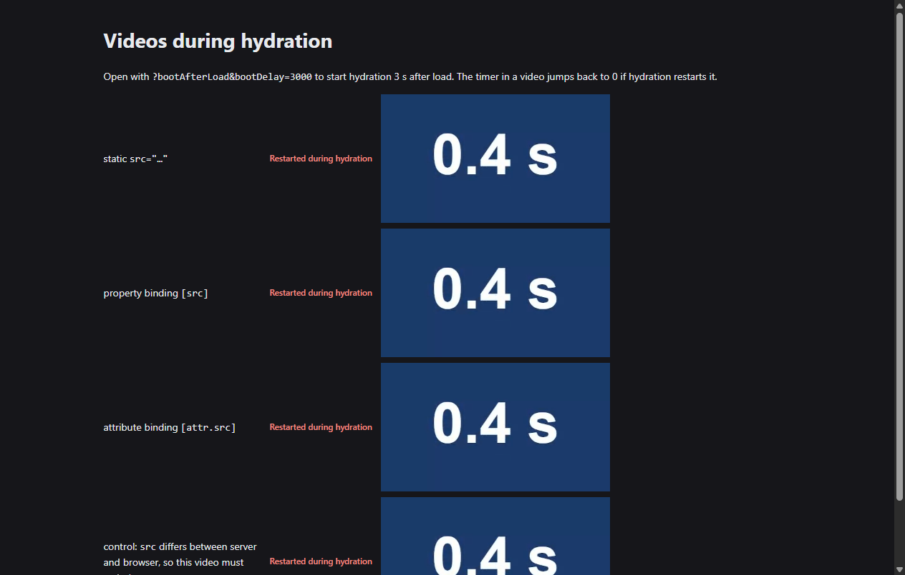
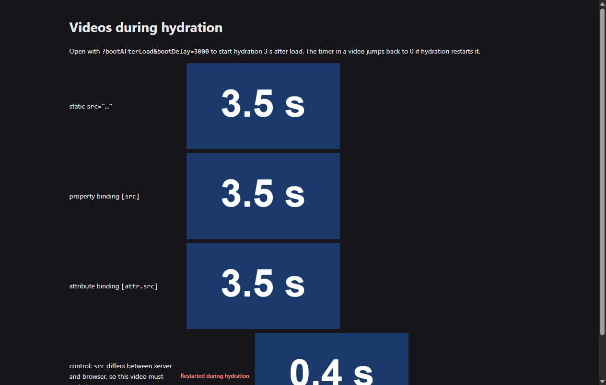

# Angular hydration writes values that the server already rendered

During hydration, Angular reuses the DOM that the server rendered. It still writes attributes and properties that already have the right value, and the browser reacts to each write. A playing video restarts, and an image selects its source again.

This repository reproduces the problems in an Angular 22.2.5 server-rendered app and measures two fixes:

| Fix | Issue | Pull request |
|---|---|---|
| Core: don't write unchanged values on hydrated nodes | ISSUE_CORE | PR_CORE |
| `NgOptimizedImage`: don't write unchanged attributes, and stop changing `sizes` twice | ISSUE_IMG | PR_IMG |

## Hydration restarts playing videos

The `/media` page has autoplaying videos with a timer in the picture. Hydration starts 3 seconds after the page loads. With the published packages, every timer jumps back to 0 when hydration runs:



With the fixes, the timers keep counting. The last video is a control. Its `src` differs between the server and the browser, so it must restart.



The result depends on the core fix only. [`results/media.txt`](results/media.txt) has the playback positions:

| Build | `src="…"` | `[src]` | `[attr.src]` | Control |
|---|---|---|---|---|
| `stock` | restarts | restarts | restarts | restarts |
| `directive-fix` | restarts | restarts | restarts | restarts |
| `core-fix` | keeps playing | keeps playing | keeps playing | restarts |
| `both-fixes` | keeps playing | keeps playing | keeps playing | restarts |

## `NgOptimizedImage` makes the browser select each image again

The `/` page shows 200 `NgOptimizedImage` images with a responsive `srcset` and a `(load)` handler. Two things happen to each image during hydration:

- `NgOptimizedImage` writes `src`, `srcset`, and its other attributes again, with the values that the server rendered.
- Angular writes `width`, `height`, and `sizes` from the template. On a lazy image the server rendered `sizes="auto, …"`, so Angular removes `auto`, and the directive then adds it back.

Each write to one of these attributes makes the browser select the source again. The browser also fires `load` again on images that loaded before hydration. Angular's event replay already delivers the original `load` event, so a `(load)` handler runs twice on those images. With the fixes it runs once.

## What the fixes change

Hydration time is the time from `bootstrapApplication()` until `ApplicationRef.whenStable()`, in headless Chrome 156. Each value is the median of 7 page loads. On the image grid, hydration starts after the window `load` event, so the 30 images in the 1280×900 viewport have loaded before hydration. The `/table` page has 300 rows of static classes, ARIA attributes, and SVG icons, and only 2 images.

| Page and CPU | `stock` | `directive-fix` | `core-fix` | `both-fixes` |
|---|---|---|---|---|
| Image grid, no throttling | 39.0 ms | 13.5 ms (−65%) | 40.7 ms (+4%) | 12.5 ms (−68%) |
| Image grid, 4× CPU throttling | 258.3 ms | 69.3 ms (−73%) | 244.5 ms (−5%) | 68.7 ms (−73%) |
| Table, no throttling | 26.2 ms | 26.2 ms (0%) | 12.4 ms (−53%) | 11.8 ms (−55%) |
| Table, 4× CPU throttling | 171.3 ms | 167.0 ms (−3%) | 66.6 ms (−61%) | 65.8 ms (−62%) |

The two fixes help different pages, so each row has one fix that matters. Differences of a few percent are within the variation between runs.

| Page | Measure | `stock` | `directive-fix` | `core-fix` | `both-fixes` |
|---|---|---|---|---|---|
| Image grid | Attribute writes | 3,637 | 1,207 | 2,432 | 406 |
| Image grid | `load` events fired again | 30 | 0 | 30 | 0 |
| Image grid | `(load)` handler calls for 30 loaded images | 60 | 30 | 60 | 30 |
| Table | Attribute writes | 12,961 | 12,941 | 365 | 349 |
| Table | Elements restyled after hydration | 1,247 | 1,243 | 45 | 43 |

The complete output is in [`results/timings.txt`](results/timings.txt) and [`results/dom-writes.txt`](results/dom-writes.txt). In every build and on every page, the DOM after hydration is the same as in `stock`, apart from two things that the comparison ignores on purpose. Those are the `(load)` counters on the image grid and the marker that `/media` sets on a restarted video.

## Run it yourself

You need Google Chrome and a Node.js version that Angular CLI 22.2 supports (`^22.22.3`, `^24.15.0`, or `>=26.0.0`). If Chrome isn't in its default location, set `CHROME_PATH`.

1. Install the packages and build the four variants:

   ```sh
   npm ci
   npm run build:variants
   ```

2. Start a build, and open <http://localhost:4000/media?bootAfterLoad&bootDelay=3000>. Reload the page to watch the timers:

   ```sh
   npm run serve:stock
   ```

   To compare, stop the server and run `npm run serve:both-fixes`.

3. Reproduce the results in `results/`:

   ```sh
   npm run check:videos   # Do the videos restart? (about 30 seconds)
   npm run check:writes   # Which attributes are written, and is the final DOM the same?
   npm run bench          # Hydration time (about 10 minutes)
   ```

## How the builds work

The app in `src/` is the same in every build. `npm run build:variants` patches the published Angular packages in `node_modules`, builds the app, and restores the packages. [`bench/patch.mjs`](bench/patch.mjs) holds the patches, which contain the same changes as the pull requests.

| Build | Patches |
|---|---|
| `stock` | None |
| `directive-fix` | The `NgOptimizedImage` pull request |
| `core-fix` | The core pull request |
| `both-fixes` | Both pull requests |

The measurements come from Chrome only. The video clip is a generated 12-second WebM file (`tools/make-clip.mjs`). The images all come from the app's own server (`/img/*`), so the benchmark doesn't depend on the network.
